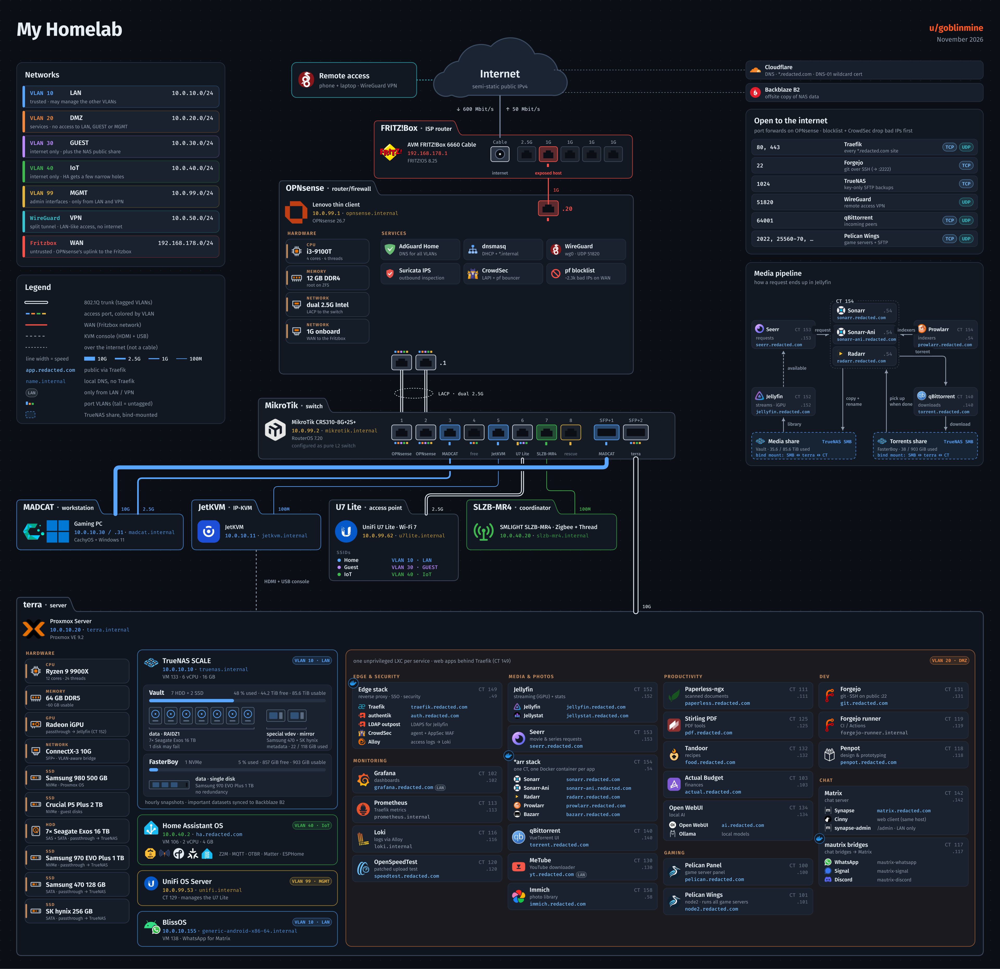

# homelab-diagram

[English](README.md) | [Tiếng Việt](README.vi.md)

Script đứng sau sơ đồ mạng homelab của tôi mà tôi đã đăng trên r/homelab. Nó biến một file YAML mô tả lab thành một sơ đồ SVG/PNG lớn theo phong cách các sơ đồ bạn thường thấy trên r/homelab.



> [!IMPORTANT]
> **Đây không phải là một công cụ dùng chung.** *Nội dung* đến từ `inventory.yaml`, nhưng *bố cục* (vị trí của từng hộp, cổng và dây cáp) được đặt thủ công trong `build.py` cho đúng mạng của tôi. Nếu bạn muốn dùng cho mạng của mình, hãy chuẩn bị tinh thần phải dời các toạ độ trong code. Hãy coi nó là một điểm khởi đầu, không phải một sản phẩm hoàn chỉnh.

> [!NOTE]
> **Code này do AI viết.** Tôi xây dựng nó cùng với Claude (Anthropic) trong Claude Code. Tôi mô tả điều mình muốn và góp ý trên từng bản render, Claude viết và thay đổi code. Một vài prompt ví dụ nằm ở cuối README này.

## Sơ đồ thể hiện những gì

- đường đi từ internet qua router của ISP (với các cổng thật của nó) và tường lửa đến switch trung tâm
- từng cổng switch kèm các VLAN trên đó (vạch cao = untagged, vạch ngắn = tagged)
- dây cáp mà **độ dày của nét vẽ là tốc độ liên kết đã đàm phán** (10G / 2.5G / 1G / 100M), trunk được vẽ thành cáp trắng lõi đậm
- các thiết bị với tên, loại, model, IP · hostname và hệ điều hành
- máy chủ Proxmox với phần cứng của nó, các VM/CT ngoài DMZ, các pool TrueNAS (đĩa, vdev, dung lượng đã dùng) và mọi container trong DMZ kèm CT ID, IP và hostname của chúng
- các container chạy nhiều app được gộp thành một thẻ với một hàng cho mỗi app
- những gì được mở ra internet, một bảng chú giải, bảng các mạng và một phần giải thích nhỏ về "media pipeline"

## Cách hoạt động

- `inventory.yaml` chứa mọi thứ bức tranh thể hiện: VLAN, thiết bị, cổng switch, port forward, phần cứng, container, pool.
- `build.py` vẽ sơ đồ dưới dạng SVG với các toạ độ đặt thủ công, nhúng các icon và chuyển nó thành PNG bằng `rsvg-convert`. Độ rộng chữ của một vài nhãn được đo bằng Pillow từ font thật, để các tab và huy hiệu vừa khít với nội dung chữ của chúng.
- **Ẩn thông tin nhạy cảm:** theo mặc định, domain thật được thay bằng `redacted.com` và các SSID được đặt tên chung chung, để có thể đăng PNG công khai. `python3 build.py --unredacted` sẽ render một bản riêng tư với các giá trị thật từ `inventory.yaml`.

## Yêu cầu

- Python 3.11+ với **PyYAML** và **Pillow** (Pillow là tuỳ chọn, nhưng giúp độ rộng nhãn chính xác). Cả hai đều được khai báo trong `pyproject.toml`, nên [uv](https://docs.astral.sh/uv/) sẽ cài chúng cho bạn — xem bên dưới.
- **rsvg-convert** (librsvg) để xuất PNG
- các font **Fira Sans** và **Fira Code** đã được cài (được tìm qua fontconfig)

Trên Arch/CachyOS: `pacman -S python-yaml python-pillow librsvg ttf-fira-sans ttf-fira-code`
Trên Debian/Ubuntu: `apt install python3-yaml python3-pil librsvg2-bin fonts-firacode` cộng thêm Fira Sans
Trên macOS: `brew install librsvg`, rồi cài các font Fira từ [mozilla/Fira](https://github.com/mozilla/Fira) (ví dụ `brew install --cask font-fira-code font-fira-sans`, nếu Homebrew của bạn có chúng).

## Cách dùng

Với [uv](https://docs.astral.sh/uv/) (tạo `.venv` và cài các dependency đã ghim từ `uv.lock`):

```bash
uv sync                         # once: create .venv, install PyYAML + Pillow
uv run fetch_icons.py           # downloads the service icons into icons/ (once)
uv run build.py                 # → out/homelab.svg + out/homelab.png (redacted)
uv run build.py --unredacted    # → out/homelab-unredacted.svg + .png
```

Hoặc với một bản cài Python thông thường có PyYAML:

```bash
python3 fetch_icons.py          # downloads the service icons into icons/ (once)
python3 build.py                # → out/homelab.svg + out/homelab.png (redacted)
python3 build.py --unredacted   # → out/homelab-unredacted.svg + .png
```

Các icon dịch vụ **không** nằm trong repo này, `fetch_icons.py` tải chúng từ [homarr-labs/dashboard-icons](https://github.com/homarr-labs/dashboard-icons). Chỉ các glyph nhỏ của riêng tôi (`icons/glyph-*.svg`: CPU, RAM, SSD, …) mới được đưa vào.

## Tuỳ biến cho mạng của bạn

1. Thay `inventory.yaml` bằng mạng của bạn. Nội dung chữ, IP, cổng, màu VLAN và các nhóm container đều đến từ đó.
2. Xem bản render. Những thứ không vừa là vấn đề bố cục: phần trên cùng (cloud, router ISP, tường lửa, switch, hàng thiết bị) và cách chia cột bên trong thẻ server là các toạ độ trong `build.py` (tìm `fy, fh`, `ox, oy`, `bx, by`, `DY`, `MAD = …`).
3. Icon mới: thả một file SVG vào `icons/` và dùng tên file của nó trong inventory.

## Dùng cùng Claude Code

Repo chứa một file [`CLAUDE.md`](CLAUDE.md) với mọi thứ một AI agent cần để tuỳ biến sơ đồ này cho lab của bạn: code được cấu trúc ra sao, phần nào của bố cục bị hardcode, những câu hỏi cần hỏi về mạng của bạn, vòng lặp render-rồi-kiểm tra, và các quy tắc thiết kế mà sơ đồ này tuân theo.

Clone repo, mở nó bằng [Claude Code](https://claude.com/claude-code) và nói điều gì đó như *"help me make this diagram for my homelab"*. Nó sẽ phỏng vấn bạn về mạng của bạn (hoặc đọc tài liệu của bạn nếu bạn có), viết lại `inventory.yaml`, tuỳ biến `build.py` và lặp lại việc render cùng bạn. Các agent khác cũng có thể dùng cùng file đó làm ngữ cảnh.

## Sơ đồ này được tạo ra như thế nào

Tôi đã thấy những sơ đồ này trên r/homelab suốt nhiều năm và luôn muốn có một cái cho mạng của mình. Hệ thống của tôi được ghi chép trong một Obsidian vault (do một phiên Claude Code khác viết, đối chiếu với các hệ thống đang chạy), nên quy trình là:

1. **Thu thập dữ kiện.** Claude Code đọc tài liệu và lấp các khoảng trống bằng các kiểm tra chỉ-đọc trên các hệ thống đang chạy: tốc độ liên kết từ switch, model đĩa và dung lượng pool từ TrueNAS, model router từ trang thông tin của nó, hostname từ DNS, các container đang chạy trong từng CT.
2. **Bản nháp đầu tiên.** Claude viết `inventory.yaml` và `build.py`, render PNG và tự nhìn vào hình ảnh (cùng các ảnh cắt phóng to) để bắt các chỗ chồng chéo trước khi cho tôi xem.
3. **Lặp lại.** Sau đó là tôi góp ý, Claude thay đổi code, render lại và kiểm tra lại, khoảng 60 vòng. Hầu hết các quyết định thiết kế (thẻ thiết bị hình thư mục, độ dày nét = tốc độ, CT ở trên và IP ở dưới, không có cổng nội bộ, …) đều ra đời từ quá trình qua lại đó.
4. **Xuất bản.** Cho repo này, Claude tạo một bản sao đã dọn dẹp (domain ví dụ, SSID chung chung), thêm script tải icon và kiểm tra rằng một bản clone mới tinh render ra đúng hình ảnh đã đăng.

Công cụ: Claude Code với Claude Opus 5.5, Python, librsvg, Pillow.

## Ví dụ về các prompt đã dùng

Khoảng 60 prompt đã được dùng. Ba prompt tiêu biểu, để bạn hình dung quá trình qua lại trông như thế nào:

**Bắt đầu**
> Bạn có biết các sơ đồ mạng mà mọi người đăng trên r/homelab không? Tôi muốn một cái cho mạng của mình. Hệ thống của tôi được ghi chép trong Obsidian vault của tôi, hãy đọc nó và kiểm tra các hệ thống đang chạy để tìm những gì còn thiếu.

**Góp ý về thiết kế**
> Hãy dùng độ dày của nét vẽ để thể hiện tốc độ liên kết và đặt một nhãn tốc độ nhỏ ở nơi mỗi dây cáp chạm tới một thiết bị. Đồng thời bỏ các tên interface như em0 hay igc0 đi, không ai cần chúng trên một sơ đồ.

**Sửa lại dữ kiện**
> Chỗ đó chưa đúng hẳn: có hai share. qBittorrent chỉ tải xuống share Torrents, và khi một lượt tải hoàn tất, Sonarr/Radarr sao chép file với tên đúng vào share Media. qBittorrent hoàn toàn không có quyền truy cập share Media.

## Ghi công & giấy phép

- Code và các glyph icon trong `icons/`: MIT, xem [LICENSE](LICENSE).
- Icon dịch vụ: [homarr-labs/dashboard-icons](https://github.com/homarr-labs/dashboard-icons), được tải bởi `fetch_icons.py`, không phải một phần của repo này. Các logo thuộc về dự án của chúng.
- Font: [Fira Sans / Fira Code](https://github.com/mozilla/Fira) (SIL Open Font License), không được đính kèm.
